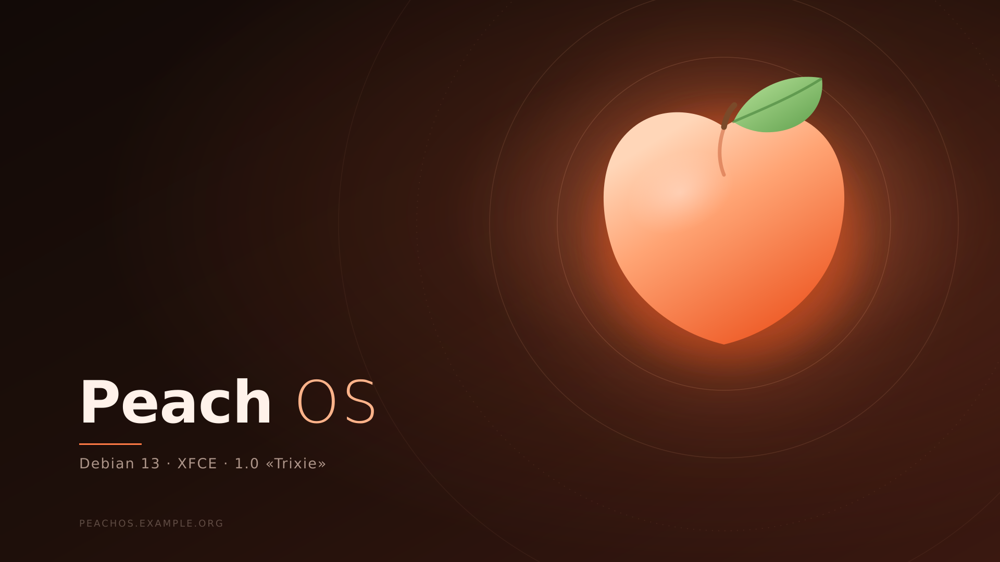

# Peach OS 1.0 «Trixie»

Distribuzione Linux **live** basata su **Debian 13 (trixie)** con desktop **XFCE**
(e **KDE Plasma** selezionabile), costruita con `live-build`. Avvia sia in **BIOS**
che in **UEFI**, è in italiano e ha un'identità visiva dedicata (tema pesca,
sfondi e splash originali).

**Sito del progetto:** https://artiombilash9-ctrl.github.io/peach-os/ — sorgente
in [`docs/`](docs/), pubblicato su GitHub Pages dalla branch `main`.



## Caratteristiche

| Componente | Scelta |
|---|---|
| Base | Debian 13 «trixie», kernel `linux-image-amd64` |
| Desktop | XFCE 4.20 (predefinito) e KDE Plasma selezionabile in LightDM |
| Tema | Arc, icone Papirus, accento pesca (#ff7a45), GTK 2/3/4 e XFWM coerenti |
| Applicazioni | Firefox ESR, Thunderbird, LibreOffice, GIMP, VLC, Transmission, GParted, Synaptic |
| Hardware | firmware `non-free-firmware` + microcodice Intel/AMD |
| Lingua | `it_IT.UTF-8`, tastiera italiana, fuso `Europe/Rome` |
| Utente | `peach` / password `live`, sudo senza password |
| Avvio | GRUB ibrido BIOS + UEFI, menu e splash brandizzati, Plymouth con tema Peach |
| Installazione | Calamares con branding Peach (supporta BIOS e UEFI) |
| Persistenza | Voce dedicata nel menu per una partizione etichettata `persistence` |
| Aggiornamenti | Via `apt` dai repository Debian (nessun archivio proprietario) |
| Secure Boot | Catena di avvio UEFI firmata da Debian (shim + GRUB) |
| Mouse nel bootloader | GRUB con supporto mouse USB su BIOS |
| Sicurezza | SELinux in modalità permissive, firewall ufw con interfaccia gufw |
| Sito | https://artiombilash9-ctrl.github.io/peach-os/ |

## Requisiti

### Per usare Peach OS

| Componente | Minimo | Consigliato |
|---|---|---|
| CPU | x86-64 (amd64) a 1 GHz | dual-core o superiore |
| RAM | 2 GB (sessione live) | 4 GB o più |
| Supporto di avvio | chiavetta USB da 4 GB (ISO da 2,2 GB) | 8 GB+, per usare anche la persistenza |
| Disco per l'installazione | 15 GB (controllo di Calamares) | 25 GB+ |
| Video | VESA / UEFI GOP, 1024×768 | 1920×1080 (sfondo e tema) |
| Firmware | BIOS o UEFI | UEFI con Secure Boot (catena firmata inclusa) |
| Rete | scheda supportata dal kernel | connessione per gli aggiornamenti Debian |

I firmware `non-free-firmware` e il microcodice Intel/AMD sono inclusi, quindi
Wi-Fi e schede grafiche comuni funzionano senza installazioni aggiuntive.

### Per costruire la ISO

- **Windows 10/11 con WSL2** (distro predefinita: `Ubuntu`) — oppure un host **Debian 13**
- ~10 GB liberi e connessione internet (la prima build scarica ~2 GB di pacchetti)
- 4 GB di RAM (consigliati 8)

## Build

### Da Windows (consigliato)

```powershell
powershell -ExecutionPolicy Bypass -File .\build.ps1
```

Lo script:

1. prepara un chroot **Debian 13** isolato in `/srv/peach-build` (solo la prima volta);
2. sincronizza il progetto e normalizza i permessi;
3. esegue `live-build` (20–40 minuti circa);
4. copia il risultato in `dist\PeachOS-1.0-amd64.iso` + checksum SHA-256.

### Su Debian 13 nativo

```bash
sudo apt install live-build debootstrap debian-archive-keyring \
    syslinux-common syslinux-utils isolinux grub-pc-bin grub-efi-amd64-bin \
    mtools dosfstools squashfs-tools xorriso
sudo ./build.sh
```

`build.sh` pulisce automaticamente lo stadio `binary` prima di ricostruire,
perché `live-build` non rileva le modifiche alla configurazione e altrimenti
salterebbe la creazione della ISO. Se i file di configurazione generati da
`live-build` (`config/common`, `config/bootstrap`, …) non ci sono — per esempio
dopo aver sincronizzato i soli sorgenti — `build.sh` li rigenera da `auto/config`:
senza questo passaggio la build userebbe i valori predefiniti (`distribution
testing`) e ricostruirebbe il chroot con la distribuzione sbagliata.

| Comando | Effetto |
|---|---|
| `./build.sh` | ricostruisce lo stadio binary (veloce, ~5 min) |
| `./build.sh --full` | ricostruisce anche il chroot (lento, 20–40 min) |
| `./build.sh --no-clean` | non pulisce nulla: usalo solo se non hai modificato niente |

## Provarla

```bash
./run-qemu.sh
```

Oppure scrivi la ISO su una chiavetta con `dd`, Rufus o balenaEtcher:
l'immagine è ibrida e avvia sia in BIOS che in UEFI.

**Credenziali:** utente `peach`, password `live`; `sudo` senza password.

Per una verifica automatica senza display, `tools/screenshot-vm.py` avvia la ISO in
QEMU e salva degli screenshot:

```bash
./tools/screenshot-vm.py dist/PeachOS-1.0-amd64.iso --out screenshots
./tools/screenshot-vm.py dist/PeachOS-1.0-amd64.iso --out screenshots-uefi --uefi
./tools/screenshot-vm.py dist/PeachOS-1.0-amd64.iso --out screenshots-sb --secure-boot
```

## Struttura del progetto

```
auto/
  config                     opzioni di live-build (distro, kernel, bootloader...)
build.ps1                    build da Windows via WSL
build.sh                     build su Linux (root)
run-qemu.sh                  avvio di prova in QEMU
config/
  package-lists/*.list.chroot pacchetti installati (core, desktop, app, installer)
  hooks/normal/*.hook.chroot  personalizzazioni eseguite nel chroot
  hooks/normal/*.hook.binary  personalizzazioni eseguite prima di creare la ISO
  includes.chroot/            file copiati nel filesystem della ISO
  includes.binary/            file aggiunti alla ISO (font e traduzione del menu GRUB)
  includes.chroot/etc/calamares/branding/peach/   tema di Calamares
  includes.chroot/usr/share/plymouth/themes/peach/ tema di avvio Plymouth
  bootloaders/                splash e tema del menu GRUB
tools/                        setup ambiente, sync, build nel chroot, raccolta ISO
```

## Personalizzazione rapida

| Cosa | Dove |
|---|---|
| Sfondo del desktop | `config/includes.chroot/usr/share/backgrounds/peachos/peach-wallpaper.svg` |
| Sfondo alternativo | `.../peach-dawn.svg` |
| Logo / icona | `config/includes.chroot/usr/share/pixmaps/peachos-logo.svg` |
| Pacchetti | `config/package-lists/*.list.chroot` |
| Tema e icone | `config/includes.chroot/etc/xdg/xfce4/xfconf/xfce-perchannel-xml/xsettings.xml` |
| Nome e versione | `config/includes.chroot/etc/os-release` + `auto/config` |
| Splash di avvio | `config/bootloaders/splash.svg` |
| Menu GRUB | `config/bootloaders/grub-pc/live-theme/theme.txt` + `0300-peach-bootmenu.hook.binary` |
| Installatore Calamares | `config/includes.chroot/etc/calamares/branding/peach/` |
| Tema Plymouth | `config/includes.chroot/usr/share/plymouth/themes/peach/` |
| Aggiornamenti | `config/includes.chroot/usr/local/bin/peach-update` |
| Tema GTK | `config/includes.chroot/etc/skel/.config/gtk-{3.0,4.0}/gtk.css` e `.gtkrc-2.0` |
| Font del menu GRUB | `config/includes.binary/boot/grub/fonts/peach16.pf2` (nome `Peach Sans Mono Regular 16`) |
| Traduzione del menu GRUB | `config/includes.binary/boot/grub/locale/it.mo` (messaggi interni, es. conto alla rovescia) |
| Applicazioni nel menu | `config/includes.chroot/usr/share/applications/` |

Dopo ogni modifica basta rilanciare `build.ps1` (o `build.sh`).

## Come funziona

1. `auto/config` genera la configurazione di `live-build` (Debian 13, XFCE, ISO ibrida).
2. `live-build` crea un chroot Debian con i pacchetti delle liste.
3. Gli hook `*.hook.chroot` applicano locale, timezone, permessi e branding.
4. L'hook `0150` configura Calamares con il branding Peach, abilita il tema
   Plymouth e rigenera l'initramfs; l'hook `0200` pulisce l'immagine.
5. Gli hook `*.hook.binary` rinominano le voci del menu GRUB, caricano il font
   con gli accenti, attivano la traduzione italiana, impostano il timeout e
   aggiungono la voce di avvio con persistenza.
6. Il chroot viene compresso in SquashFS e inserito nella ISO con GRUB (BIOS + UEFI).
7. `build.sh` rinomina l'immagine in `dist/PeachOS-1.0-amd64.iso` e ne calcola lo SHA-256.

## Installazione su disco

Dalla sessione live apri **Installa Peach OS** (icona sulla Scrivania o voce nel
menu). Vengono avviati Calamares e la configurazione Debian (`calamares-settings-debian`)
con il branding Peach: lingua, tastiera, partizionamento, utente e bootloader.
I file del sistema vengono presi da `/run/live/medium/live/filesystem.squashfs`;
al termine l'installatore rimuove i pacchetti live e configura i repository Debian.

## Persistenza

Le modifiche alla sessione live vengono conservate avviando con la voce
**Peach OS 1.0 — Live con persistenza** e preparando una partizione etichettata
`persistence` (su chiavetta o disco):

```bash
sudo mkfs.ext4 -L persistence /dev/sdXN        # SOSTITUISCI sdXN!
sudo mkdir -p /mnt/persist
sudo mount /dev/sdXN /mnt/persist
echo "/ union" | sudo tee /mnt/persist/persistence.conf
sudo umount /mnt/persist
```

`/ union` rende persistente l'intero filesystem; per salvare solo la cartella
dell'utente usa `/home union`. Senza la partizione la voce di avvio si comporta
come una normale sessione live.

## Aggiornamenti

Non esiste un archivio Peach OS dedicato: pacchetti e aggiornamenti arrivano dai
repository Debian (`trixie`, `trixie-security`, `trixie-updates`). La voce
**Aggiorna Peach OS** apre un terminale ed esegue `apt update` e `apt full-upgrade`.

## Secure Boot

L'avvio UEFI usa `shim-signed` e `grub-efi-amd64-signed` forniti da Debian: la
catena di avvio è firmata con le chiavi Debian/Microsoft e anche il kernel è
firmato da Debian. Su PC con Secure Boot attivo non è necessario disattivarlo
né registrare chiavi MOK aggiuntive.

In lockdown GRUB rifiuta i comandi grafici non firmati: in Secure Boot il menu
viene mostrato in modalità testuale e può comparire un avviso non bloccante
(«prohibited by secure boot policy») prima del menu. L'avvio prosegue
normalmente; i test con firmware OVMF Microsoft arrivano al menu e avviano il
kernel.

## Tema e avvio grafico

Il tema Peach copre GTK 2, GTK 3 e GTK 4, il window manager XFWM, le icone
Papirus e il greeter LightDM. La sequenza di avvio è brandizzata in due passaggi:
splash del menu GRUB e Plymouth con il tema `peach` (logo centrato e indicatore
di avvio), inclusa nell'initramfs. Il menu GRUB include il supporto mouse USB
sui sistemi BIOS.

## KDE Plasma

Oltre a XFCE (sessione predefinita) la ISO include **KDE Plasma**: dal menu delle
sessioni di LightDM, in alto a destra, scegli «Plasma». Il colore d'accento di
Plasma è impostato sul pesca di Peach OS.

## Sicurezza

- **SELinux** è installato con la policy Debian e avviato in modalità
  `permissive`: registra le violazioni senza bloccare le applicazioni. Su un
  sistema installato puoi passare a `enforcing` con `sudo peach-selinux-enforce`,
  dopo aver controllato i log con `sudo ausearch -m AVC -ts recent`.
- **ufw** è configurato con «nega in ingresso, consenti in uscita» e abilitato.
  Per gestirlo in grafica apri **Firewall** (gufw), presente nel menu di XFCE e
  di Plasma.

## Prossimi passi

- Aggiungere un repository apt Peach OS solo se si intende distribuire pacchetti
  propri; al momento la distro usa esclusivamente Debian.

## Note legali

Peach OS è un progetto dimostrativo e non è affiliato a Debian, XFCE, Mozilla,
The Document Foundation o ad altri progetti citati. «Debian» è un marchio della
Software in the Public Interest, Inc. Le immagini e i loghi inclusi sono originali
e rilasciabili con la stessa licenza del progetto.
